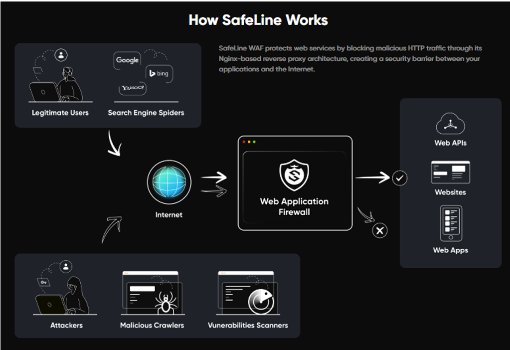
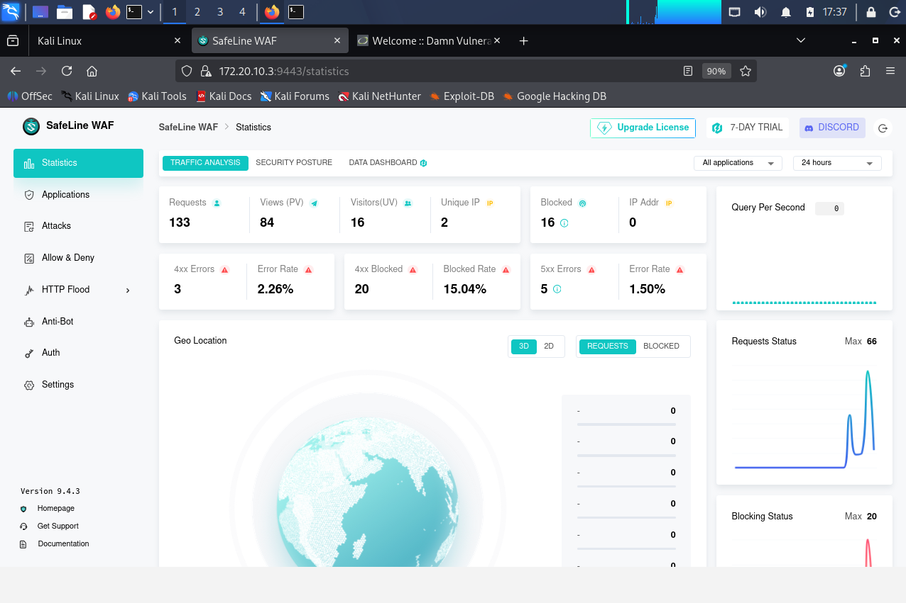
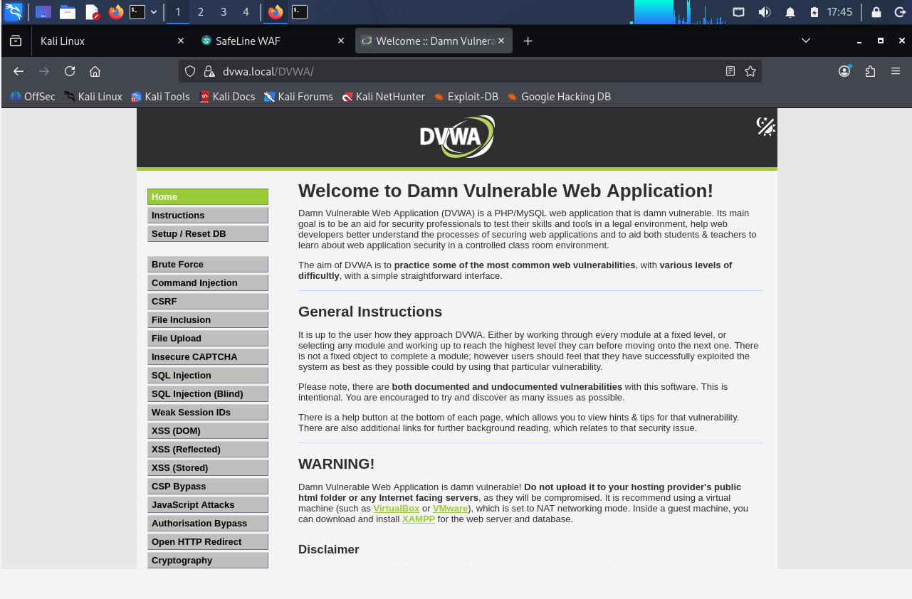
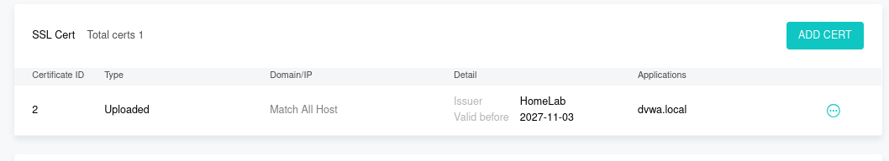
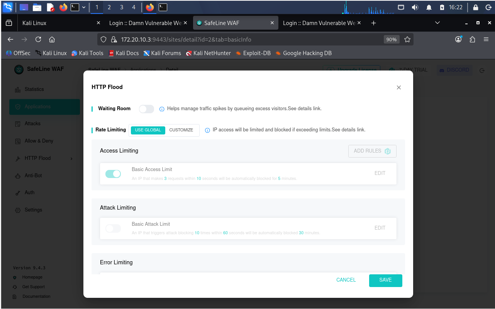
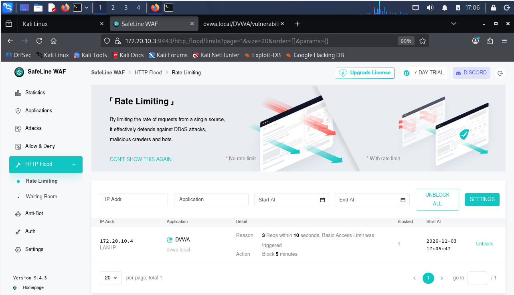
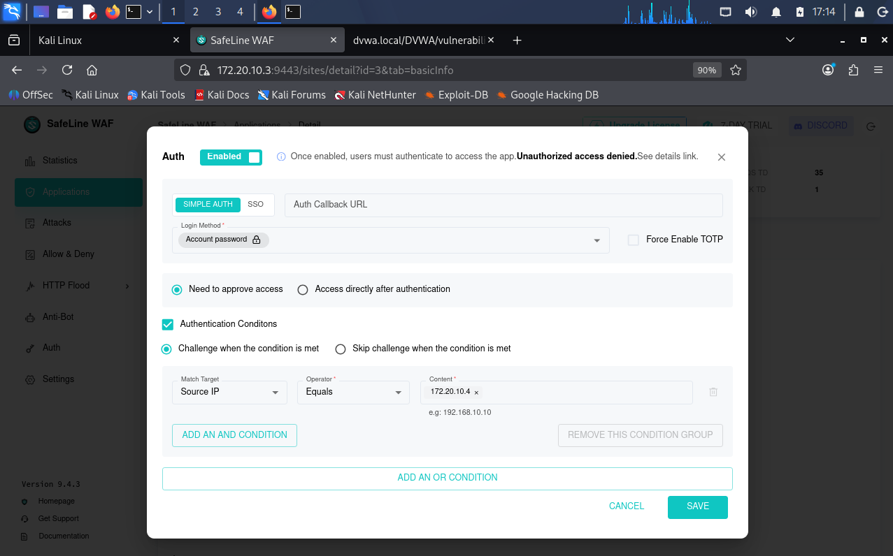
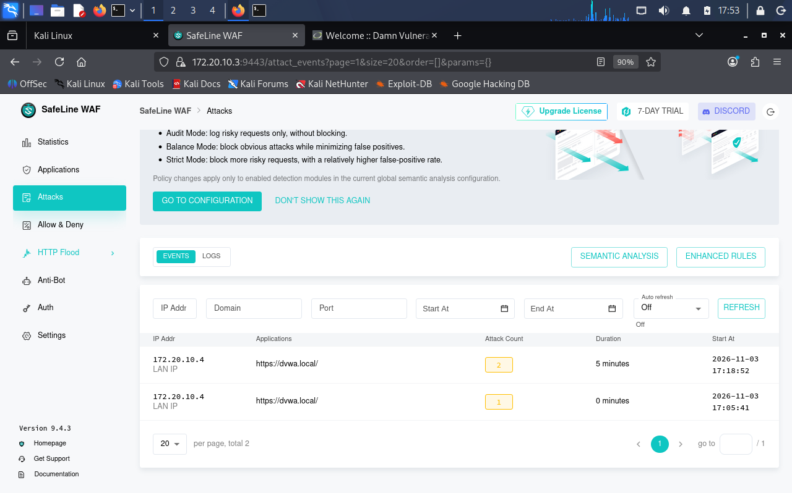

# SafeLine WAF – DVWA Web Application Security Lab

## Project Overview

This project demonstrates the deployment and configuration of **SafeLine Web Application Firewall (WAF)** to protect a deliberately vulnerable web application, **Damn Vulnerable Web Application (DVWA)**.

The lab was built using Ubuntu Server and Kali Linux virtual machines. SafeLine was configured as a reverse-proxy WAF to inspect incoming web traffic and provide protection against malicious requests.

The project focuses on practical web application security, HTTPS configuration, HTTP Flood testing, authentication security checks, and WAF monitoring.

## Objectives

- Deploy and configure SafeLine WAF.
- Host DVWA on an Ubuntu Server.
- Configure SafeLine as a reverse proxy.
- Configure HTTPS using a self-signed SSL certificate.
- Perform HTTP Flood testing in a controlled lab.
- Test authentication-related security controls.
- Observe WAF traffic and security events.

## Lab Environment

| Component | Configuration |
|---|---|
| Host system | VirtualBox |
| WAF | SafeLine WAF |
| Vulnerable application | DVWA |
| Server OS | Ubuntu Server |
| Testing OS | Kali Linux |
| Web server | Apache |
| Database | MySQL |
| Backend port | 8080 |
| WAF HTTPS port | 443 |
| SafeLine management port | 9443 |
| SSL | Self-signed certificate |

## Lab Architecture

**Traffic flow:**

1. Kali Linux acts as the security testing machine.
2. Requests are sent to the DVWA hostname.
3. SafeLine WAF receives incoming HTTPS traffic on port 443.
4. SafeLine inspects requests and applies configured security rules.
5. Permitted traffic is forwarded to the DVWA backend hosted on Ubuntu Server at port 8080.

## Implementation and Configuration

### 1. Ubuntu Server Preparation

- Updated Ubuntu packages.
- Installed Apache, PHP, MySQL, OpenSSL, and required components.
- Configured the Apache web server to listen on port 8080.
- Prepared the DVWA database and application configuration.

### 2. DVWA Deployment

- Configured the DVWA application on Ubuntu Server.
- Created and configured the MySQL database.
- Verified DVWA accessibility.
- Configured local hostname resolution using `/etc/hosts`.

### 3. SSL Certificate Configuration

- Generated a self-signed SSL certificate using OpenSSL.
- Created the certificate and private key.
- Imported the certificate and key into SafeLine.
- Configured the protected application to accept HTTPS traffic.

### 4. SafeLine WAF Deployment

- Installed SafeLine WAF using its deployment script.
- Accessed the SafeLine management dashboard.
- Added DVWA as a protected application.
- Configured reverse proxy forwarding to the Ubuntu backend.
- Configured HTTPS on port 443.

## Screenshots and Evidence

### SafeLine Dashboard

### DVWA Application

### SSL Certificate Configuration

### HTTP Flood Testing

### HTTP Flood Protection

### Authentication Security Testing

### WAF Security Events and Logs

## Security Testing and Demonstrations

### 1. HTTP Flood Testing

Performed HTTP Flood testing against the protected DVWA application from the Kali Linux testing machine in the isolated lab environment.

**What this demonstrates:**
- Generation of repeated HTTP requests.
- Observation of incoming traffic.
- Evaluation of SafeLine's HTTP Flood protection.
- Monitoring of traffic and security events.

### 2. Authentication Security Checks

Performed authentication-related testing against the DVWA application and reviewed the configured SafeLine security controls.

**What this demonstrates:**
- Authentication testing in a vulnerable web application.
- Observation of access behaviour.
- Understanding of WAF authentication-related protection features.

### 3. SQL Injection Testing – Limitation

SQL Injection was part of the planned testing scope. However, the DVWA SQL Injection endpoint returned an HTTP 500 Internal Server Error during testing.

Therefore, a successful SQL Injection demonstration could not be verified and is not claimed as a completed test.

## Demonstration Videos

The project includes practical recordings of the HTTP Flood and authentication testing.

- **HTTP Flood Demonstration:** [Add video link here]
- **Authentication Testing Demonstration:** [Add video link here]

## Key Learnings

- Practical deployment of a Web Application Firewall.
- Reverse proxy configuration and traffic forwarding.
- HTTPS and SSL certificate configuration.
- Web application security testing.
- HTTP Flood protection concepts.
- Authentication security controls.
- WAF monitoring and security event analysis.
- Working with Ubuntu Server, Kali Linux, Apache, and DVWA.

## Tools and Technologies

`SafeLine WAF` `DVWA` `Ubuntu Server` `Kali Linux` `VirtualBox` `Apache` `MySQL` `PHP` `OpenSSL` `HTTPS` `Reverse Proxy`

## Disclaimer

This project was performed in a controlled home lab environment using intentionally vulnerable software. All testing was conducted against systems configured for educational and security-learning purposes. Do not perform security testing against systems without explicit authorization.

## Author

**Pramukh J Padmashali**

Cybersecurity | SOC | Network Security | Web Application Security

GitHub: [pramukhjp-ai](https://github.com/pramukhjp-ai)

